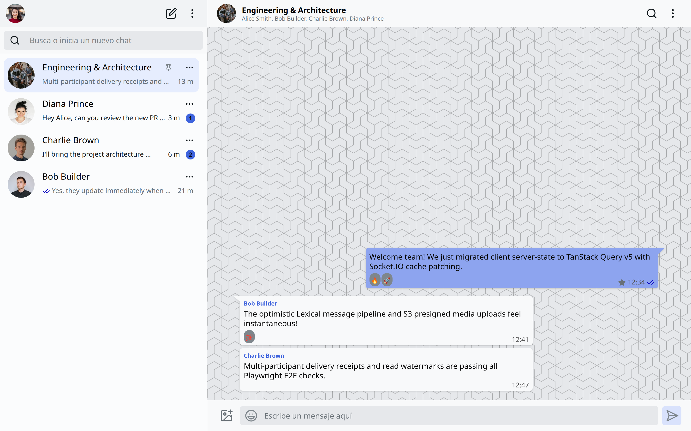
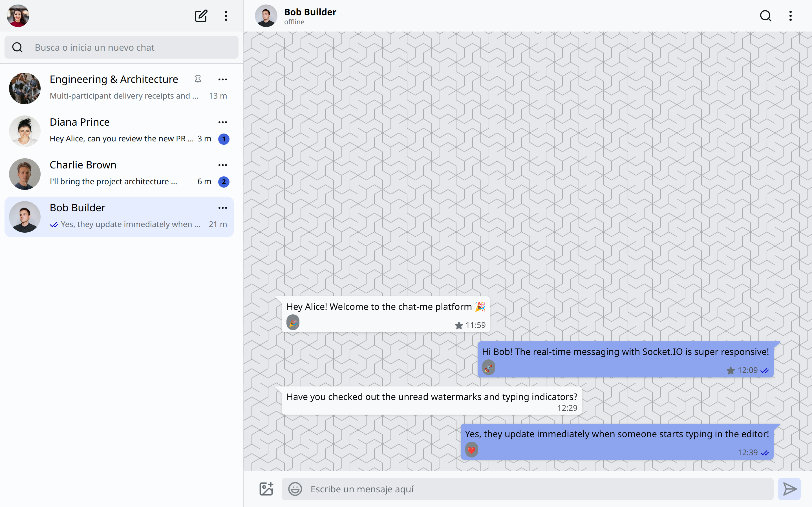
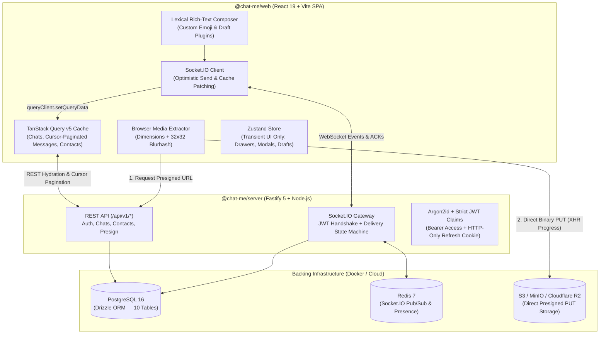

# ChatMe — Full-Stack Real-Time Messaging Platform

A real-time web messaging platform supporting 1-on-1 direct chats and multi-participant group conversations, rich-text composition with **Meta's Lexical**, optimistic UI delivery states, and direct-to-S3 media uploads.

| Group Conversation & Reactions | Direct Chat & Delivery Receipts |
| :---: | :---: |
|  |  |

---

## Architectural Evolution: From Client Prototype to Full-Stack Monorepo

This project began as a deep-dive frontend challenge built from scratch to master complex client-side React state, accessible UI primitives (**Radix UI** + **Framer Motion**), and **Meta's Lexical** rich-text editor framework.

As the application grew, storing all conversations, messages, and UI state inside a single client-side Zustand store exposed real-world scaling limits: unbounded memory growth, no cursor-based history pagination, and no multi-user persistence. Rather than leaving it as a static frontend clone, I re-architected `chat-me` into a **Turborepo full-stack monorepo** backed by **Fastify**, **Socket.IO**, **PostgreSQL 16**, **Redis**, and **S3/MinIO object storage**.

---

## System Architecture



---

## Key Engineering Decisions (ADRs)

All core architectural trade-offs are documented in [`docs/adr/`](./docs/adr/) and [`docs/spec/`](./docs/spec/):

1. **[Hybrid Client State Architecture (ADR 0003)](./docs/adr/0003-hybrid-tanstack-query-zustand-state.md)**
   - **Problem**: A monolithic Zustand store holding nested message arrays (`state.chats[i].messages`) prevented cursor pagination and required manual cache invalidation.
   - **Solution**: Decoupled server-synchronized entities from transient UI state. **TanStack Query v5** manages `chats`, cursor-paginated `messages` (`useInfiniteQuery` in 40-message batches), and `contacts`, while inbound Socket.IO events mutate the query cache directly via `queryClient.setQueryData`. **Zustand** is strictly restricted to transient UI state (drawers, modals, search filters, and local Lexical drafts)—enforced in CI via [`scripts/lint-state.sh`](./scripts/lint-state.sh).

2. **[Retain & Modernize Vite SPA over Next.js App Router (ADR 0002)](./docs/adr/0002-retain-and-modernize-vite-spa.md)**
   - **Problem**: Evaluating whether to migrate the React SPA to Next.js App Router.
   - **Solution**: Retained Vite + React 19 + **TanStack Router** (`/c/$chatId`). SSR/RSC provides zero benefit for an authenticated private messenger, introduces hydration mismatches with DOM-imperative editors like **Lexical**, and cannot hold stateful WebSocket connections in serverless functions.

3. **[Zero-Proxy Direct Media Upload Pipeline (ADR 0004)](./docs/adr/0004-media-storage-and-upload-pipeline.md)**
   - **Problem**: Proxying multi-megabyte images, videos, and audio notes through the Node.js event loop degrades WebSocket latency.
   - **Solution**: The browser extracts dimensions, orientation (`square`, `landscape`, `portrait`), and a 32x32 Canvas **Blurhash** preview before requesting a short-lived cryptographic presigned `PUT` URL (`POST /api/v1/chats/:chatId/media/presign`). Binary payloads stream directly from the browser to S3/MinIO via `XMLHttpRequest` with real-time upload progress rings and zero layout shift.

4. **[Fastify + Socket.IO + PostgreSQL 16 Backend (ADR 0001)](./docs/adr/0001-fastify-socketio-backend.md)**
   - **Real-Time Delivery State Machine**: Messages progress deterministically from client-generated UUID optimistic insertion (`idle` clock) → server database persistence ACK (`send` single tick) → recipient WebSocket receipt (`received` double gray tick) → active viewport intersection (`read` double blue tick + `last_read_at` watermark update).
   - **Idempotent Direct Chats**: Enforced at the PostgreSQL schema level via a deterministic `direct_pair_hash` (`LEAST(u1, u2) || ':' || GREATEST(u1, u2)`), preventing duplicate 1-on-1 threads under concurrent creation races.

---

## Hybrid Manual & Guardrailed Agentic Engineering

This project combines **hand-crafted frontend engineering** with **spec-driven agentic workflows**:

- **Manual Foundation**: Built the React component hierarchy, custom **Lexical** editor nodes/plugins (serialized AST rich text, emoji synchronization, keyboard command listeners), Radix UI dialogs, and Framer Motion drawer transitions by hand to master complex React state and DOM-imperative APIs.
- **Human-Authored Specifications & ADRs**: Designed the relational schema, WebSocket event contracts ([`docs/spec/data-model-and-event-contracts.md`](./docs/spec/data-model-and-event-contracts.md)), client data layer ([`docs/spec/client-data-layer-architecture.md`](./docs/spec/client-data-layer-architecture.md)), and media pipeline ([`docs/spec/media-storage-and-upload-pipeline.md`](./docs/spec/media-storage-and-upload-pipeline.md)).
- **Deterministic Guardrails for AI Agents**: Rather than "vibe coding", AI agents were orchestrated against strict mechanical verification gates:
  - **Ubiquitous Domain Language**: Canonical terms defined in [`GLOSSARY.md`](./GLOSSARY.md) (`chat`, `participant`, `receipt`, `read_watermark`, `delivery_status`) are enforced across code and comments by [`scripts/lint-glossary.sh`](./scripts/lint-glossary.sh).
  - **Architectural Boundary Linters**: [`scripts/lint-state.sh`](./scripts/lint-state.sh) blocks reading server collections from Zustand, and [`scripts/lint-network.sh`](./scripts/lint-network.sh) prohibits hardcoded localhost ports in client code ([`CODING_STANDARDS.md`](./CODING_STANDARDS.md)).
  - **Dual-High-Seam Automated Testing**: Every feature is verified at two high-value seams:
    1. **Backend Integration Seam**: Vitest suites exercising Fastify + Socket.IO against real PostgreSQL, Redis, and MinIO containers.
    2. **Multi-User Browser E2E Seam**: Playwright tests spawning two simultaneous browser contexts (Alice & Bob) to verify real-time messaging, typing indicators, delivery receipt transitions (`idle` → `send` → `received` → `read`), and media lightbox interactions.

---

## Quickstart (Local Development)

### Prerequisites
- **Node.js** >= 20 (v22 recommended)
- **pnpm** (`corepack enable`)
- **Docker** & **Docker Compose**

### 1. Start Backing Infrastructure (PostgreSQL, Redis, MinIO)
```bash
docker compose up -d --wait
```

### 2. Install Dependencies & Seed Demo Data
```bash
pnpm install
pnpm db:seed
```

### 3. Run the Full-Stack Development Environment
```bash
pnpm dev
```
- **Web App**: `http://localhost:5173` (Vite proxies `/api` and `/socket.io` to port `3001`)
- **Backend API & Socket.IO**: `http://localhost:3001`

### Trying Real-Time Messaging Locally
Open `http://localhost:5173` in a regular browser window and a second **Incognito/Private** window side by side:
1. Click **"Demo as Alice"** in Window 1 and **"Demo as Bob"** in Window 2 (or use any of the seeded accounts below with password `Password123!`).
2. Open the **Bob Builder** direct chat or the **Engineering & Architecture** group chat to test real-time messages, typing indicators, emoji reactions, starred messages, and delivery receipts.

| Seeded Account | Password | Pre-loaded State |
| :--- | :--- | :--- |
| `alice@example.com` | `Password123!` | Admin of **Engineering & Architecture** group, active chat with Bob, unread badges from Charlie (2) & Diana (1), starred messages |
| `bob@example.com` | `Password123!` | Active direct chat with Alice, member of **Engineering & Architecture** group |
| `charlie@example.com` | `Password123!` | 2 unread messages sent to Alice, member of **Engineering & Architecture** group |
| `diana@example.com` | `Password123!` | 1 unread message sent to Alice, member of **Engineering & Architecture** group |

---

## Monorepo Layout & Quality Gates

```text
chat-me/
├── apps/
│   ├── web/                # React 19, Vite, TanStack Router & Query, Zustand, Lexical, Playwright E2E
│   └── server/             # Fastify 5, Socket.IO, Drizzle ORM, PostgreSQL, Redis, S3 Presigner
├── packages/
│   ├── shared/             # Shared TypeScript contracts, Zod schemas, Socket.IO event types
│   └── tsconfig/           # Shared strict TypeScript configurations
├── docs/
│   ├── adr/                # Architecture Decision Records (0001–0004)
│   └── spec/               # Full-stack engineering specifications
├── scripts/                # Mechanical architecture & glossary linters
├── GLOSSARY.md             # Ubiquitous domain language
└── CODING_STANDARDS.md     # Enforced engineering rules & CI pipeline gates
```

### Available Scripts
```bash
pnpm dev          # Start web (5173) and server (3001) concurrently via Turborepo
pnpm build        # Build shared packages, backend, and production frontend bundle
pnpm lint         # Run ESLint + mechanical glossary, network, and state boundary linters
pnpm typecheck    # Full monorepo TypeScript verification
pnpm test         # Run all unit and container-backed integration test suites
pnpm db:migrate   # Run Drizzle PostgreSQL schema migrations
pnpm db:seed      # Seed PostgreSQL with demo users, direct chats, group chat, and reactions
pnpm health       # Probe PostgreSQL, Redis, and MinIO readiness
```
