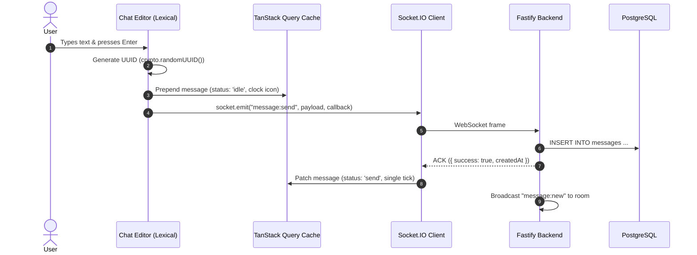

# Client Data Layer & Real-Time Sync Architecture

Architecture specification for frontend state management, real-time cache synchronization, and optimistic UI transitions in `chat-me`.

---

## 1. Architectural Overview & State Boundaries

To ensure desktop-class responsiveness and eliminate unbounded memory growth, the frontend state is strictly split into two layers:

```
┌─────────────────────────────────────────────────────────────────────────────┐
│                             Chat-Me Frontend                                │
├──────────────────────────────────────┬──────────────────────────────────────┤
│       Server-State Cache             │         Client UI Store              │
│       (TanStack Query v5)            │            (Zustand)                 │
├──────────────────────────────────────┼──────────────────────────────────────┤
│ • Chat list & summaries              │ • Drawer visibility & active views   │
│ • Message histories (paginated)      │ • Active modal / dialog states       │
│ • Contact list                       │ • Local Lexical editor text drafts   │
│ • User profile & preferences         │ • Active theme mode & color palette  │
│ • WebSocket event cache patching     │ • Ephemeral typing indicators        │
│ • Optimistic dispatch queue          │ • Real-time socket connection state  │
└──────────────────────────────────────┴──────────────────────────────────────┘
```

---

## 2. TanStack Query Conventions & Query Keys

### 2.1 Standard Query Keys
```typescript
export const chatKeys = {
  all: ["chats"] as const,
  lists: () => [...chatKeys.all, "list"] as const,
  detail: (chatId: string) => [...chatKeys.all, "detail", chatId] as const,
  messages: (chatId: string) => [...chatKeys.all, "messages", chatId] as const,
  contacts: ["contacts"] as const,
  user: ["user", "me"] as const,
};
```

### 2.2 Message Pagination (`useInfiniteQuery`)
Instead of loading thousands of messages into a single array:
- Messages are fetched in chunks (e.g. 40 messages per page) using a cursor:
  `GET /api/chats/:chatId/messages?cursor=<messageId>&limit=40`
- Query cache stores pages: `{ pages: [MessagePage, MessagePage, ...], pageParams: [...] }`
- Virtualized scroll container triggers `fetchNextPage()` when scrolling upward toward older history.

---

## 3. Real-Time Socket.IO Synchronization Bridge (`useSocketSync`)

A global singleton hook mounts inside the root application shell and attaches listeners to the Socket.IO client instance, updating TanStack Query cache directly in memory:

```typescript
export function useSocketSync() {
  const queryClient = useQueryClient();
  const currentChatId = useStore((state) => state.currentChatId);

  useEffect(() => {
    const socket = getSocket();

    // 1. Inbound New Message
    socket.on("message:new", (newMsg: TMessage) => {
      // Append to active message thread cache if present
      queryClient.setQueryData(
        chatKeys.messages(newMsg.chatId),
        (oldData: InfiniteData<MessagePage> | undefined) => {
          if (!oldData) return oldData;
          return {
            ...oldData,
            pages: oldData.pages.map((page, idx) =>
              idx === 0
                ? { ...page, messages: [newMsg, ...page.messages] }
                : page
            ),
          };
        }
      );

      // Update chat list summary: bump to top & increment unread if not active chat
      queryClient.setQueryData(chatKeys.lists(), (oldChats: TChat[] | undefined) => {
        if (!oldChats) return oldChats;
        const targetChat = oldChats.find((c) => c.id === newMsg.chatId);
        if (!targetChat) {
          // If brand new chat, invalidate to fetch full details
          queryClient.invalidateQueries({ queryKey: chatKeys.lists() });
          return oldChats;
        }

        const isViewing = currentChatId === newMsg.chatId;
        const updatedChat: TChat = {
          ...targetChat,
          messages: [newMsg], // Holds latest preview message
          hasUnreadMsg: isViewing ? 0 : targetChat.hasUnreadMsg + 1,
        };

        return [updatedChat, ...oldChats.filter((c) => c.id !== newMsg.chatId)];
      });

      // If user is currently viewing this chat, emit read ack immediately
      if (currentChatId === newMsg.chatId) {
        socket.emit("message:ack_read", {
          chatId: newMsg.chatId,
          lastMessageId: newMsg.id,
        });
      } else {
        // Confirm receipt to server
        socket.emit("message:ack_received", {
          chatId: newMsg.chatId,
          messageIds: [newMsg.id],
        });
      }
    });

    // 2. Delivery Receipt Status Updates (Single gray -> Double gray -> Double blue)
    socket.on("message:status_changed", ({ messageId, chatId, status }) => {
      queryClient.setQueryData(
        chatKeys.messages(chatId),
        (oldData: InfiniteData<MessagePage> | undefined) => {
          if (!oldData) return oldData;
          return {
            ...oldData,
            pages: oldData.pages.map((page) => ({
              ...page,
              messages: page.messages.map((m) =>
                m.id === messageId ? { ...m, status } : m
              ),
            })),
          };
        }
      );
    });

    // 3. Message Reaction Updates
    socket.on("message:reaction_updated", ({ messageId, chatId, reactions }) => {
      queryClient.setQueryData(
        chatKeys.messages(chatId),
        (oldData: InfiniteData<MessagePage> | undefined) => {
          if (!oldData) return oldData;
          return {
            ...oldData,
            pages: oldData.pages.map((page) => ({
              ...page,
              messages: page.messages.map((m) =>
                m.id === messageId ? { ...m, reactions } : m
              ),
            })),
          };
        }
      );
    });

    // 4. Message Tombstoning ("Delete for everyone")
    socket.on("message:deleted", ({ messageId, chatId }) => {
      queryClient.setQueryData(
        chatKeys.messages(chatId),
        (oldData: InfiniteData<MessagePage> | undefined) => {
          if (!oldData) return oldData;
          return {
            ...oldData,
            pages: oldData.pages.map((page) => ({
              ...page,
              messages: page.messages.map((m) =>
                m.id === messageId
                  ? { ...m, body: "This message was deleted", hasMedia: null }
                  : m
              ),
            })),
          };
        }
      );
    });

    // 5. Reconnection Synchronization
    socket.on("connect", () => {
      // Re-synchronize chat list and unread tallies missed while disconnected
      queryClient.invalidateQueries({ queryKey: chatKeys.lists() });
      if (currentChatId) {
        socket.emit("chat:join", currentChatId);
        queryClient.invalidateQueries({ queryKey: chatKeys.messages(currentChatId) });
      }
    });

    return () => {
      socket.off("message:new");
      socket.off("message:status_changed");
      socket.off("message:reaction_updated");
      socket.off("message:deleted");
      socket.off("connect");
    };
  }, [queryClient, currentChatId]);
}
```

---

## 4. Optimistic Dispatch Flow

When the user submits a message:



If the acknowledgment times out or fails (e.g. network lost):
- The message remains in cache with `status: 'idle'` (or an explicit `status: 'error'`).
- A red retry icon appears allowing the user to tap and re-dispatch with the exact same UUID (idempotent retry).

---

## 5. Refactoring Plan for Existing Zustand Store

The existing Zustand slices in `src/lib/store/slices/` are refactored as follows:

| Existing Slice | Target Action | Description |
| :--- | :--- | :--- |
| `ChatSlice.ts` | **Refactor** | Retain active chat ID and search filter state; move `chats: TChat[]` array to TanStack Query (`useChats()`). |
| `MessageSlice.ts` | **Replace** | Replace message arrays with TanStack Query mutations & `useSocketSync`. Retain only ephemeral message draft text. |
| `LeftDrawerSlice.ts` | **Keep 100%** | Pure client UI drawer navigation (`PROFILE`, `NOTIFICATIONS`, `PRIVACY`, etc.). |
| `RightDrawerSlice.ts` | **Keep 100%** | Pure client UI drawer for contact info, starred messages, and media preview. |
| `ProfileSlice.ts` | **Split** | Server user profile moves to `useUser()`; client theme/privacy settings remain in Zustand with `persist`. |
| `LoadingSlice.ts` | **Simplify** | Replaced by TanStack Query `isLoading` and Socket.IO `isConnected` states. |
| `MediaMessageSlice.ts`| **Keep** | Manages client-side media upload staging dialogs before send. |
